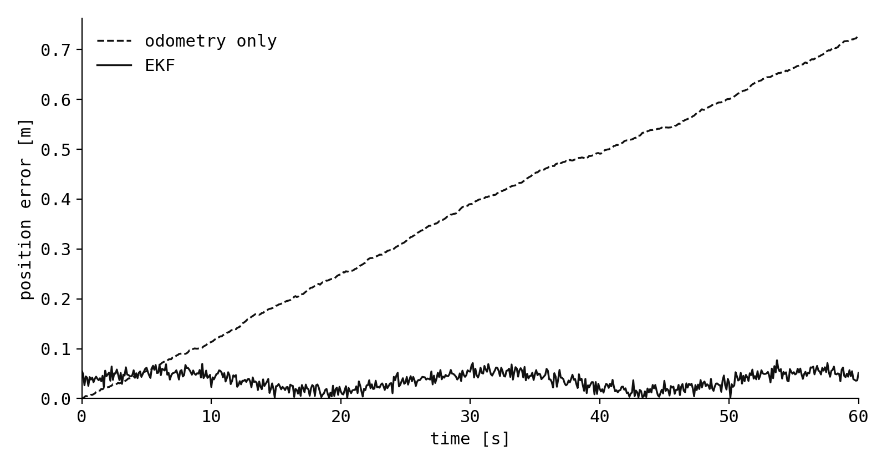

*This is a sample note, written to test the layout with code and math.*

A differential-drive robot on a flat floor has three numbers worth knowing: where it is and which way it faces. Wheel odometry gives a smooth estimate of all three, and it drifts. An extended Kalman filter (EKF) is the standard way to combine that estimate with a sensor that does not drift, and this note walks through the smallest version of it.

## State and motion model

The state is the pose $\mathbf{x} = (x, y, \theta)^\top$. The control input is the velocity command $\mathbf{u} = (v, \omega)^\top$: forward speed and turn rate. Over a short time step $\Delta t$ the pose moves as

$$
f(\mathbf{x}, \mathbf{u}) =
\begin{pmatrix}
x + v \cos\theta \, \Delta t \\
y + v \sin\theta \, \Delta t \\
\theta + \omega \, \Delta t
\end{pmatrix}.
$$

The model is nonlinear in $\theta$, which is why the plain Kalman filter does not apply. The EKF linearises it around the current estimate, using the Jacobian

$$
\mathbf{F} = \frac{\partial f}{\partial \mathbf{x}} =
\begin{pmatrix}
1 & 0 & -v \sin\theta \, \Delta t \\
0 & 1 & \phantom{-}v \cos\theta \, \Delta t \\
0 & 0 & 1
\end{pmatrix}.
$$

## Predict

Prediction moves the estimate with the model and grows its covariance $\mathbf{P}$ by the process noise $\mathbf{Q}$:

$$
\begin{aligned}
\hat{\mathbf{x}}_{k|k-1} &= f(\hat{\mathbf{x}}_{k-1|k-1}, \mathbf{u}_k) \\
\mathbf{P}_{k|k-1} &= \mathbf{F}_k \mathbf{P}_{k-1|k-1} \mathbf{F}_k^\top + \mathbf{Q}
\end{aligned}
$$

Run on its own, this step is dead reckoning: the uncertainty only ever grows.

## Update

Suppose a sensor measures position directly, $\mathbf{z} = (x, y)^\top$ plus noise with covariance $\mathbf{R}$. This is roughly what a GNSS receiver or a scan matcher against a known map provides. The measurement model is linear, $\mathbf{z} = \mathbf{H}\mathbf{x}$, with

$$
\mathbf{H} = \begin{pmatrix} 1 & 0 & 0 \\ 0 & 1 & 0 \end{pmatrix}.
$$

The update weighs the prediction against the measurement through the Kalman gain $\mathbf{K}$:

$$
\begin{aligned}
\mathbf{K}_k &= \mathbf{P}_{k|k-1} \mathbf{H}^\top \left( \mathbf{H} \mathbf{P}_{k|k-1} \mathbf{H}^\top + \mathbf{R} \right)^{-1} \\
\hat{\mathbf{x}}_{k|k} &= \hat{\mathbf{x}}_{k|k-1} + \mathbf{K}_k \left( \mathbf{z}_k - \mathbf{H} \hat{\mathbf{x}}_{k|k-1} \right) \\
\mathbf{P}_{k|k} &= \left( \mathbf{I} - \mathbf{K}_k \mathbf{H} \right) \mathbf{P}_{k|k-1}
\end{aligned}
$$

The heading $\theta$ is never measured, yet it is still corrected: the prediction step correlates heading error with position error through $\mathbf{F}$, and the gain uses that correlation.

## In Python

```python
import numpy as np

H = np.array([[1.0, 0.0, 0.0],
              [0.0, 1.0, 0.0]])


def wrap(angle: float) -> float:
    """Wrap an angle to [-pi, pi)."""
    return (angle + np.pi) % (2 * np.pi) - np.pi


def predict(x, P, u, Q, dt):
    v, w = u
    c, s = np.cos(x[2]), np.sin(x[2])
    F = np.array([[1.0, 0.0, -v * s * dt],
                  [0.0, 1.0,  v * c * dt],
                  [0.0, 0.0,  1.0]])
    x = x + np.array([v * c * dt, v * s * dt, w * dt])
    x[2] = wrap(x[2])
    return x, F @ P @ F.T + Q


def update(x, P, z, R):
    S = H @ P @ H.T + R              # innovation covariance
    K = P @ H.T @ np.linalg.inv(S)   # Kalman gain
    x = x + K @ (z - H @ x)
    x[2] = wrap(x[2])
    return x, (np.eye(3) - K @ H) @ P
```

Two details matter in practice. The heading has to be wrapped after every step, or an estimate near $\pm\pi$ jumps by a full turn. And $\mathbf{Q}$ and $\mathbf{R}$ are the only tuning knobs: their ratio decides how much the filter trusts the model over the sensor.

## Result



| Estimator     | Mean error [m] | Error at 60 s [m] |
| :------------ | -------------: | ----------------: |
| Odometry only |           0.37 |              0.73 |
| EKF           |           0.04 |              0.05 |

In ROS 2 there is no reason to write this by hand: the `robot_localization` package implements the same filter for a full 3D state and any number of sensors.[^rl] Writing the planar version once is still the fastest way to understand what its parameters do.

[^rl]: T. Moore and D. Stouch, "A Generalized Extended Kalman Filter Implementation for the Robot Operating System", 2014.
