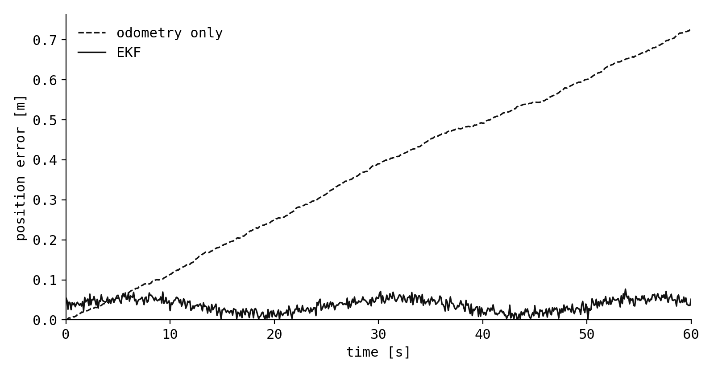

This note contains every element a note can use, so the whole design can be judged on one page. This first paragraph is plain running text, long enough to show the measure, the line height and how the serif sets over several lines. Inline styles: *emphasis*, **strong emphasis**, ~~strikethrough~~, `inline code`, a [link to the home page](/) and a footnote reference.[^first]

A second paragraph, to show the space between paragraphs. Smart punctuation turns "straight quotes" into curly ones, two hyphens into an en dash (pages 10--12), three into an em dash---like this---and three dots into an ellipsis...

## Headings

The title above is a level-one heading. Sections of a note start at level two.

### Level three heading

Text under a level-three heading.

#### Level four heading

Text under a level-four heading. Deeper levels are not styled; a note that needs them probably wants to be two notes.

## Lists

Unordered:

- Lidar odometry
- Wheel odometry
  - Left and right encoder ticks
  - Slips on wet floors
- IMU

Ordered:

1. Predict the state with the motion model.
2. Compare the prediction with the measurement.
3. Correct the state by a weighted share of the difference.

Task list:

- [x] Write the note
- [x] Check the equations
- [ ] Publish

## Code

Inline code looks like `ros2 topic echo /odom`. A block with syntax highlighting, in Python:

```python
import numpy as np

def predict(x: np.ndarray, P: np.ndarray, u: np.ndarray, Q: np.ndarray, dt: float):
    """Propagate the state and its covariance through the motion model."""
    v, w = u
    theta = x[2]
    # Jacobian of the motion model with respect to the state
    F = np.array([
        [1.0, 0.0, -v * np.sin(theta) * dt],
        [0.0, 1.0,  v * np.cos(theta) * dt],
        [0.0, 0.0,  1.0],
    ])
    x = x + np.array([v * np.cos(theta) * dt, v * np.sin(theta) * dt, w * dt])
    return x, F @ P @ F.T + Q
```

In C++, with a line long enough to scroll horizontally:

```cpp
#include <rclcpp/rclcpp.hpp>
#include <nav_msgs/msg/odometry.hpp>

class OdomListener : public rclcpp::Node {
public:
  OdomListener() : Node("odom_listener") {
    // Keep only the latest message: old odometry is useless to a controller.
    sub_ = create_subscription<nav_msgs::msg::Odometry>("odom", rclcpp::SensorDataQoS().keep_last(1), [this](nav_msgs::msg::Odometry::ConstSharedPtr msg) { last_ = msg; });
  }

private:
  rclcpp::Subscription<nav_msgs::msg::Odometry>::SharedPtr sub_;
  nav_msgs::msg::Odometry::ConstSharedPtr last_;
};
```

A shell session and a YAML file:

```bash
colcon build --symlink-install --packages-select my_localization
source install/setup.bash && ros2 launch my_localization ekf.launch.py use_sim_time:=true
```

```yaml
ekf_node:
  ros__parameters:
    frequency: 50.0        # Hz
    two_d_mode: true
    odom0: /wheel/odometry
```

And a block without a language:

```
[INFO] [ekf_node]: filter initialised, waiting for /wheel/odometry
```

## Math

Inline math sits in the text: the state is $\mathbf{x} = (x, y, \theta)^\top$ and its covariance is $\mathbf{P} \in \mathbb{R}^{3 \times 3}$. Display equations are centred:

$$
\mathbf{K}_k = \mathbf{P}_{k|k-1} \mathbf{H}_k^\top \left( \mathbf{H}_k \mathbf{P}_{k|k-1} \mathbf{H}_k^\top + \mathbf{R}_k \right)^{-1}
$$

A wide equation scrolls sideways on a small screen instead of breaking the page:

$$
p(\mathbf{x}_k \mid \mathbf{z}_{1:k}, \mathbf{u}_{1:k}) = \eta \, p(\mathbf{z}_k \mid \mathbf{x}_k) \int p(\mathbf{x}_k \mid \mathbf{x}_{k-1}, \mathbf{u}_k) \, p(\mathbf{x}_{k-1} \mid \mathbf{z}_{1:k-1}, \mathbf{u}_{1:k-1}) \, \mathrm{d}\mathbf{x}_{k-1}
$$

Aligned steps:

$$
\begin{aligned}
\hat{\mathbf{x}}_{k|k} &= \hat{\mathbf{x}}_{k|k-1} + \mathbf{K}_k \left( \mathbf{z}_k - h(\hat{\mathbf{x}}_{k|k-1}) \right) \\
\mathbf{P}_{k|k} &= \left( \mathbf{I} - \mathbf{K}_k \mathbf{H}_k \right) \mathbf{P}_{k|k-1}
\end{aligned}
$$

## Table

| Sensor          | Rate [Hz] | Noise (1σ) | Drifts |
| :-------------- | --------: | ---------: | :----: |
| Wheel encoders  |        50 |     0.02 m |  yes   |
| IMU (gyro)      |       200 | 0.01 rad/s |  yes   |
| 2D lidar        |        10 |     0.03 m |   no   |
| GNSS (RTK)      |         5 |     0.02 m |   no   |

## Image

An image written as `` takes the full column width, and the quoted text becomes its caption:



## Blockquote

> The purpose of computing is insight, not numbers.
>
> --- Richard Hamming

## Horizontal rule

Text before the rule.

---

Text after the rule.

## Footnotes

Footnotes are collected at the end of the note.[^second] The number links to the footnote and the arrow there links back.

[^first]: This is the first footnote.
[^second]: A longer footnote, with `code` and a [link](https://docs.astro.build), to show how it wraps when it runs over more than one line of the column.
